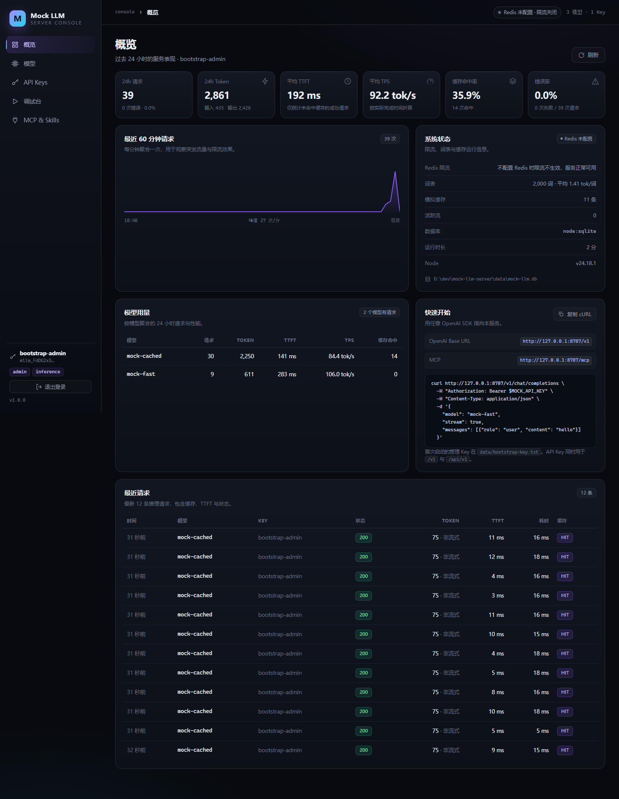
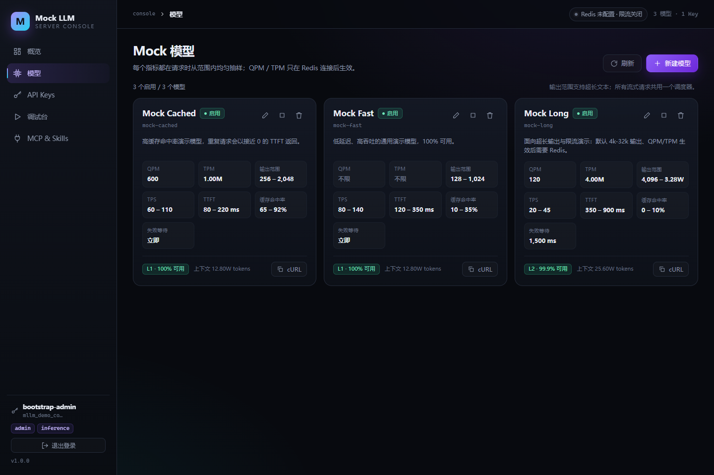

# Mock LLM Server

一个可配置的本地 mock LLM 服务：**React + Vite 管理台 + Node.js API + SQLite + 可选 Redis 限流 + HTTP MCP**。

每个 mock 模型可以配置 QPM / TPM、输出长度范围、输出 TPS、TTFT、可用性等级、失败等待时间和缓存命中率。所有范围在每次请求时随机抽样，支持流式 SSE、超长输出和高并发压测。





## 特性

- **API Key 管理**：生成、启用/停用、轮换、删除；`admin` / `inference` 两种 scope；数据库只保存 SHA-256 哈希。
- **Mock 模型**：QPM、TPM、输出 token 范围、TPS 范围、TTFT 范围、可用性等级（1 = 100%）、失败等待时间、缓存命中率范围。
- **OpenAI 兼容**：`GET /v1/models`、`POST /v1/chat/completions`，支持流式 / 非流式 / `seed` / `max_tokens`。
- **高并发 + 超长输出**：所有并发流共用一个调度器；按需生成文本，不预分配整段输出；支持背压和客户端断开清理。
- **真实感模拟**：按概率返回 503、429；缓存命中时以 3-12ms 的 TTFT 返回；响应头暴露采样结果。
- **MCP 配置模型**：Streamable HTTP 单端点 `/mcp`，提供 list / get / create / update / delete 模型和用量统计 tools。
- **Skill 文档**：`server/skills/mock-llm-server/SKILL.md`，可在管理台预览、复制、下载 ZIP。
- **SQLite 单文件存储**：无外部数据库；请求统计在内存缓冲后批量写入，避免压测时写放大。
- **可选 Redis**：配置 `REDIS_URL` 后启用按 Key + 模型 + 自然分钟的 QPM/TPM 原子限流；不配置则限流关闭、服务正常可用。

## 技术栈

| 层 | 技术 |
| --- | --- |
| 前端 | React 18 + Vite 5，手写 CSS，无 UI 框架 |
| 后端 | Node.js ESM + Express 4 |
| 数据库 | SQLite（Node 内置 `node:sqlite`，旧版本回退 `better-sqlite3`） |
| 缓存/限流 | 进程内 LRU + 可选 Redis（ioredis） |
| MCP | `@modelcontextprotocol/sdk`（Streamable HTTP、stateless、JSON response） |
| 校验 | zod |

## 目录

```
mock-llm-server/
├─ server/
│  ├─ src/
│  │  ├─ index.js             # 启动、优雅关闭
│  │  ├─ app.js               # Express 组装、静态资源、错误处理
│  │  ├─ config.js            # .env / 默认配置
│  │  ├─ db/                  # SQLite 连接、schema、seed、bootstrap Key
│  │  ├─ domain/              # 模型、API Key、请求统计、zod schema
│  │  ├─ simulation/          # 词表、随机文本、流调度、LRU 缓存
│  │  ├─ ratelimit/           # 可选 Redis QPM/TPM
│  │  ├─ routes/              # /api/v1、/v1、/mcp
│  │  ├─ mcp/                 # MCP tools、Skill 读取与 ZIP 打包
│  │  └─ middleware/          # Bearer Key 鉴权
│  ├─ scripts/                # vocab 构建、smoke、loadtest
│  └─ skills/mock-llm-server/ # SKILL.md + references
├─ web/
│  └─ src/                    # React 管理台：概览、模型、Keys、调试台、MCP
├─ docs/                      # README 截图
├─ data/                      # 运行时生成：SQLite、bootstrap-key.txt
├─ .env.example
└─ package.json               # npm workspaces
```

## 快速开始

要求：**Node.js >= 22.13（推荐 24 LTS）**，使用内置 `node:sqlite`，无原生依赖。若当前 Node 的 `node:sqlite` 仍需实验 flag，请升级 Node，或手动安装 `better-sqlite3` 作为回退驱动。

```bash
npm install
cp .env.example .env      # Windows: copy .env.example .env
npm run dev
```

- 管理台：http://127.0.0.1:5173
- API / MCP：http://127.0.0.1:8787（Vite 已代理 `/api`、`/v1`、`/mcp`）

首次启动会：

1. 在 `data/mock-llm.db` 创建 SQLite schema。
2. 创建 3 个演示模型（`mock-fast`、`mock-long`、`mock-cached`）。
3. 生成管理 Key 并打印到终端，同时写入 `data/bootstrap-key.txt`。

用该 Key 登录管理台。数据库只保存哈希，`bootstrap-key.txt` 是唯一明文副本。

生产构建：

```bash
npm run build     # 构建 web/dist
npm start         # 单端口 8787 同时提供 API + 管理台
```

## 模型指标

| 字段 | 说明 |
| --- | --- |
| `qpm_limit` | 每 API Key + 模型每分钟请求数；`0` 不限；仅 Redis 连接时生效 |
| `tpm_limit` | 每 API Key + 模型每分钟 token 数（提示词 + 预留输出）；`0` 不限 |
| `output_tokens_min` / `max` | 输出 token 范围，每次请求均匀抽样；受 `MAX_OUTPUT_TOKENS` 和上下文裁剪 |
| `tps_min` / `max` | 输出速度范围（tokens/秒），流式按此速度产出 |
| `ttft_ms_min` / `max` | 首 token 延迟范围（毫秒） |
| `availability_level` | 1=100%，2=99.9%，3=99%，4=95%，5=90%；失败返回 503 |
| `failure_delay_ms` | 可用性抽样失败时先等待的毫秒数；`0` 或留空表示立即失败，不影响 429 / 停用等错误 |
| `cache_hit_rate_min` / `max` | 缓存命中概率范围（0-100）；命中时 3-12ms 返回缓存文本 |
| `context_window` | 上下文窗口，必须 >= 输出上限 |

`failure_delay_ms` 只影响「可用性抽样失败」这一条路径：命中失败后先等待指定毫秒再返回 `503 model_unavailable`，方便模拟上游超时/重试；不填或 `0` 时立即失败。QPM/TPM 的 429 和模型停用的 503 不受它影响。

文本由 **2000 个英文词的内存词表** 随机抽样拼接，每个词的 token 数在启动 / 构建时预计算，生成时只做整数累加。句子长度、标点和大小写也会随机变化，便于观察流式效果。

更细的语义和调参建议见 [server/skills/mock-llm-server/references/metrics.md](server/skills/mock-llm-server/references/metrics.md)。

## API 示例

```bash
export MOCK_API_KEY=mllm_xxx

curl http://localhost:8787/v1/models \
  -H "Authorization: Bearer $MOCK_API_KEY"

curl http://localhost:8787/v1/chat/completions \
  -H "Authorization: Bearer $MOCK_API_KEY" \
  -H "Content-Type: application/json" \
  -d '{
    "model": "mock-fast",
    "stream": true,
    "max_tokens": 256,
    "messages": [{"role": "user", "content": "hello"}]
  }'
```

非流式响应包含标准字段和额外的 `mock` 元数据：

```json
{
  "choices": [{"message": {"role": "assistant", "content": "..."}, "finish_reason": "stop"}],
  "usage": {"prompt_tokens": 12, "completion_tokens": 356, "total_tokens": 368},
  "mock": {"cache_hit": false, "ttft_ms": 241, "tps": 112.4, "availability_level": 1, "failure_delay_ms": 0}
}
```

流式响应是标准 SSE，最终以 `data: [DONE]` 结束。响应头会带 `x-mock-cache`、`x-mock-plan-ttft-ms`、`x-mock-plan-tps`、`x-mock-output-tokens`、`x-mock-failure-delay-ms`、`x-ratelimit-*` 等调试信息。

完整接口见 [server/skills/mock-llm-server/references/api.md](server/skills/mock-llm-server/references/api.md)。

## Redis 限流（可选）

```env
REDIS_URL=redis://127.0.0.1:6379/0
```

- **不配置**：QPM/TPM 不生效，服务正常可用；响应头 `x-mock-ratelimit: off`。
- **已连接**：按 `API Key + 模型 + 自然分钟` 用 Lua 原子预扣 QPM 和 TPM；超限返回 429 + `retry-after`。
- **配置了但连接失败**：fail-open，服务继续可用，响应头 `x-mock-ratelimit: degraded`，管理台显示警告。
- Redis key 前缀默认 `mockllm`，可通过 `REDIS_PREFIX` 修改。

管理台顶栏和概览页会显示 Redis 状态。没有 Redis 也可以完整使用模型、缓存、可用性等所有其他能力。

## MCP 配置模型

MCP 地址：`http://localhost:8787/mcp`，标准 **Streamable HTTP**，无状态，`POST /mcp`。

```json
{
  "mcpServers": {
    "mock-llm-server": {
      "url": "http://localhost:8787/mcp"
    }
  }
}
```

仅支持 stdio 的客户端可以用 `npx mcp-remote http://localhost:8787/mcp` 转接。

**当前 MCP 不鉴权**（按需求实现）。默认只监听 `127.0.0.1`；如果暴露到局域网/公网，请在反向代理层加访问控制，并注意任何能访问 `/mcp` 的客户端都能增删模型。

Tools：

| Tool | 说明 |
| --- | --- |
| `get_server_info` | 地址、鉴权方式、Redis 状态、词表、指标语义 |
| `list_models` / `get_model` | 查询模型 |
| `create_model` | 创建模型，参数与 REST 一致 |
| `update_model` | 局部更新指标 |
| `delete_model` | 删除模型 |
| `get_usage_stats` | 1h/6h/24h/7d 用量统计 |

MCP 只做模型配置和统计，不提供 Key 管理，避免绕过 API Key 鉴权。

## Skill

```bash
curl http://localhost:8787/api/v1/skill
curl -o mock-llm-server.zip http://localhost:8787/api/v1/skill/download
```

管理台的「MCP & Skills」页可以预览全文、复制、下载 ZIP。Skill 描述了 MCP tools、模型指标语义、OpenAI 接口、错误码和限流行为，适合直接交给 Agent 使用。

## 高并发与超长输出

- **单一调度器**：所有流式请求共享一个 20ms `setInterval`，每个流按 `elapsed * tps` 计算应发送的 token，不为每个请求创建独立定时器。
- **按需生成**：流式请求只在 tick 时生成需要发送的词，不会预先构建整段超长文本；非流式才一次性构建。
- **背压**：`res.write()` 返回 false 时暂停该流，等待 `drain` 后追赶；客户端断开立即从调度器移除并记录 499。
- **统计批量写入**：请求记录先入内存队列，每秒批量写 SQLite；`last_used_at` 每 Key 最多 30 秒写一次。
- **认证缓存**：API Key 校验结果缓存 5 秒，撤销/轮换时主动失效。
- **输出上限**：`MAX_OUTPUT_TOKENS` 默认 1,000,000，防止误配置打满内存。生成 100 万 token 的非流式请求会占用较多内存，压测时请控制并发。
- **压测脚本**：

```bash
npm run loadtest -- --requests 500 --concurrency 100 --max-tokens 64
npm run loadtest -- --requests 200 --concurrency 50 --stream
```

- 独立的 Python 压测场景（成功率 / RPS / p50 / p95 / p99 / TTFT，带报告）：见 [api-test 的 MockLlmLoadTest](D:/project/api-test/README.md)。

## 词表

- 源词表：`server/src/simulation/wordlist.js`（约 2000+ 词，去重后截取 2000）。
- token 数：由 `server/src/lib/tokens.js` 的离线规则计算，启动时缓存；也可以生成静态文件：

```bash
npm run vocab:build
# 生成 server/src/simulation/vocab.generated.json
```

后续启动优先读取 `vocab.generated.json`，请求路径不再分词。管理台「概览」会显示实际词数和平均 token/词。

## 配置

复制 `.env.example` 为 `.env`：

| 变量 | 默认 | 说明 |
| --- | --- | --- |
| `HOST` / `PORT` | `127.0.0.1` / `8787` | 监听地址 |
| `DATA_DIR` | `./data` | SQLite 和 bootstrap Key 目录 |
| `DB_PATH` | `data/mock-llm.db` | 直接指定数据库文件 |
| `REDIS_URL` | 空 | 配置后启用限流 |
| `REDIS_PREFIX` | `mockllm` | Redis key 前缀 |
| `BOOTSTRAP_API_KEY` | 自动生成 | 首次启动使用的固定管理 Key（缺少 `mllm_` 前缀时自动补上） |
| `SEED_DEMO` | `true` | 空库时创建演示模型 |
| `MAX_OUTPUT_TOKENS` | `1000000` | 单次生成硬上限 |
| `CACHE_TTL_MS` | `600000` | 模拟缓存 TTL |
| `CACHE_MAX_ENTRIES` | `300` | 每个模型缓存条数 |
| `CACHE_MAX_CHARS` | `200000` | 单条缓存文本上限 |
| `REQUESTS_RETENTION` | `20000` | 请求历史保留条数 |
| `PUBLIC_BASE_URL` | 自动 | 对外地址，用于 MCP / Skill 展示 |
| `CORS_ORIGIN` | `*` | 允许的跨域来源 |
| `LOG_REQUESTS` | `false` | 是否打印每个请求 |
| `LOG_LEVEL` | `info` | `debug` / `info` / `warn` / `error` |

## 脚本

| 命令 | 说明 |
| --- | --- |
| `npm run dev` | 同时启动 API（8787）与 Vite（5173） |
| `npm run dev:server` / `npm run dev:web` | 单独启动 |
| `npm run build` | 构建前端到 `web/dist` |
| `npm start` | 生产模式，单端口 8787 |
| `npm run vocab:build` | 预生成词表 token 数据 |
| `npm run smoke` | 冒烟测试（需要服务已启动） |
| `npm run loadtest -- --requests 500 --concurrency 100` | 并发压测 |

## 数据模型

- `api_keys`：名称、SHA-256 哈希、前缀、scopes、启用状态、过期时间、最后使用时间。
- `models`：全部 mock 指标。
- `requests`：请求 ID、Key、模型、状态、token、缓存、TTFT、耗时、TPS；默认保留 2 万条，每 5 分钟清理。

SQLite 连接使用 WAL、`synchronous=NORMAL` 和 5 秒 busy timeout。

## 安全说明

这是一个本地 mock / 压测工具，不是生产级 LLM 网关：

- MCP 端点当前不鉴权。
- 默认监听 `127.0.0.1`，不要直接暴露到公网。
- 管理 Key 明文只存在于 `data/bootstrap-key.txt`，不要提交到 Git（`data/` 已忽略）。
- 没有用户体系、没有登录密码、没有审计日志；只有 API Key scope。
- 生成的文本是随机词表拼接，不包含真实模型输出。

## 常见问题

**`node:sqlite` 报错 / 无法打开数据库？**
升级到 Node 24 LTS（内置 `node:sqlite` 无需 flag）。旧版本可手动安装回退驱动：`npm install better-sqlite3 -w server`。

**为什么 QPM/TPM 不生效？**
需要同时满足：模型 `qpm_limit` / `tpm_limit` 大于 0，且 `REDIS_URL` 已连接。管理台顶栏会显示 `Redis 未配置 · 限流关闭`。

**为什么缓存不命中？**
请求 messages、`max_tokens`、`temperature`、`seed` 必须完全一致；抽样也必须落在缓存命中概率内。先用相同请求多试几次。

**流式输出很慢？**
TPS 是模型配置里抽样的，检查模型 TPS 范围。`mock-long` 默认 20-45 tok/s，长输出会很久；调高 TPS 或减小输出范围即可。

**Key 丢了怎么办？**
首次启动的 Key 在 `data/bootstrap-key.txt`。如果删除了所有 Key，可以停服务、删除 `data/mock-llm.db`（会丢失配置）后重启重新生成；或重启前设置 `BOOTSTRAP_API_KEY`，并删除数据库。
